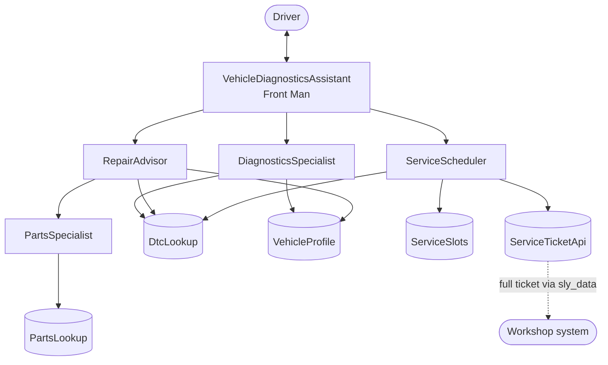

# Vehicle Diagnostics Assistant – a Neuro SAN multi-agent network

> Neuro® AI Multi-Agent Accelerator Hackathon – Track 2 submission

When a warning light comes on, most drivers don't know if they can keep driving, what the problem is, or what the
repair will cost. The **Vehicle Diagnostics Assistant** is a driver-facing multi-agent network built with
[Neuro SAN Studio](https://github.com/cognizant-ai-lab/neuro-san-studio). The driver enters an OBD-II trouble code
(DTC) such as `P0301`, or describes the symptoms in plain language. A team of agents then:

1. **says whether the car is safe to drive**. Every answer starts with this verdict, and a critical fault means
   "stop and call roadside assistance".
2. **explains the fault and its likely causes** in plain language.
3. **estimates the repair cost**: parts, labor and total, with parts availability and warranty status.
4. **books a workshop appointment** and, once the driver confirms, **opens a structured service ticket** for the
   technicians (complaint, DTCs, diagnosis, severity, recommended repairs, part numbers to prepare).

So the network serves both sides: drivers get a clear answer, and workshops receive a ticket that is ready to work
on.

---

## Agent network



| Agent | Type | Role |
| --- | --- | --- |
| `VehicleDiagnosticsAssistant` | LLM | Front Man: talks to the driver, gives the safety verdict first, delegates. |
| `DiagnosticsSpecialist` | LLM | Interprets DTCs or symptoms, reports severity, drivability and likely causes. |
| `RepairAdvisor` | LLM | Recommends repairs and computes parts + labor cost (95 EUR/h). |
| `PartsSpecialist` | LLM | Checks price, stock and lead time of parts. |
| `ServiceScheduler` | LLM | Offers slots and books the appointment only after the driver confirms. |
| `DtcLookup` | CodedTool | Mock DTC database (10 codes), lookup by code or by symptoms. |
| `VehicleProfile` | CodedTool | Make, model, powertrain, mileage and warranty, resolved from the VIN. |
| `PartsLookup` | CodedTool | Mock parts inventory with EUR prices, stock and lead time. |
| `ServiceSlots` | CodedTool | Open workshop slots over the next business days (skips weekends). |
| `ServiceTicketApi` | CodedTool | Mock work-order API: validates the booking and opens ticket `WO-xxxx`. |

The agents coordinate with Neuro SAN's **AAOSA** protocol: the Front Man asks the specialists which parts of the
request they can handle, then puts their answers together. Tools return deterministic data, so the LLMs reason
and explain instead of making up facts.

---

## Highlights

- **Safety first.** A critical fault such as `P0AA6` (high-voltage isolation fault in an EV) tells the driver to stop,
  call roadside assistance and not touch the orange high-voltage cables, before anything else is said.
- **Privacy with `sly_data`.** The VIN and the owner's name are passed as `sly_data`. The CodedTools can use them,
  but they are **never sent to an LLM**. Agents only see a masked VIN (`*************0001`).
- **A ticket for the workshop.** `ServiceTicketApi` adds the full ticket to `sly_data["service_tickets"]`, and the
  Front Man's `allow.to_upstream` policy returns it to the client application, for example to forward it to a
  workshop management system.
- **No booking without consent.** An appointment is booked only after the driver picks a slot and confirms it.
- **Bounded execution.** `max_steps` and `max_execution_seconds` are set, as Neuro SAN recommends.

---

## Files

| Path                                                                 | Content                                    |
|----------------------------------------------------------------------|--------------------------------------------|
| `registries/industry/vehicle_diagnostics_assistant.hocon`            | Agent network definition                   |
| `registries/industry/manifest.hocon`                                 | Registers and enables the network          |
| `coded_tools/industry/vehicle_diagnostics_assistant/`                | CodedTools and mock data catalogs          |
| `docs/examples/industry/vehicle_diagnostics_assistant.md`            | Detailed network documentation             |
| `tests/coded_tools/industry/vehicle_diagnostics_assistant/`          | Unit tests for every CodedTool             |
| `tests/fixtures/industry/vehicle_diagnostics_assistant/`             | Integration test fixtures (LLM-judged)     |

---

## Run it

Requires Python 3.12+ and an API key for OpenAI, Anthropic or Gemini.

```bash
git clone <this-repo-url> && cd <repo>
python -m venv .venv && source .venv/bin/activate
pip install -r requirements.txt -r requirements-build.txt
export ANTHROPIC_API_KEY=...        # or OPENAI_API_KEY / GOOGLE_API_KEY – never commit keys
python -m neuro_san_studio run      # server on :8080, nsflow UI on :4173
```

In the nsflow UI, select `industry/vehicle_diagnostics_assistant` and set the **Sly Data**:

```json
{"vin": "WVWZZZ1KZ8W000001", "customer_name": "Alex", "current_date": "2026-10-23"}
```

Demo vehicles: `WVWZZZ1KZ8W000001` (2019 VW Golf, gasoline), `WBA7E2C51KB000002` (2022 BMW 530e, plug-in hybrid),
`WMEEJ9AA5FK000003` (2023 Mercedes-Benz EQA, electric).

Command line alternative:

```bash
export PYTHONPATH=$(pwd) AGENT_TOOL_PATH=coded_tools/ AGENT_MANIFEST_FILE=registries/manifest.hocon
python -m neuro_san.client.agent_cli --agent industry/vehicle_diagnostics_assistant \
  --sly_data '{"vin": "WVWZZZ1KZ8W000001", "customer_name": "Alex", "current_date": "2026-10-23"}'
```

### Sample queries

- My check engine light is on and my scanner shows P0301. The engine shakes at red lights.
- The car shakes at idle and the check engine light is flashing. Can I keep driving?
- How much would it cost to fix code P0420?
- My EV shows a high voltage warning and code P0AA6. *(use the EQA VIN)*
- Please book me the earliest appointment to get it fixed.

### Tests

```bash
python -m pytest tests/coded_tools/industry/vehicle_diagnostics_assistant -v
python -m neuro_san_studio validate registries/industry/vehicle_diagnostics_assistant.hocon
```

---

## Demo video

The demo video was uploaded to the hackathon SharePoint, as the submission rules require.

---

## Going beyond the demo

All data is mock data and contains no client data. To use the network for real, replace `dtc_catalog.py`,
`parts_catalog.py` and `vehicle_registry.py` with calls to an OEM diagnostics database, a parts/ERP system and a
fleet or CRM system, and point `ServiceTicketApi` at a real dealer management system.

---

Built on [Neuro SAN Studio](https://github.com/cognizant-ai-lab/neuro-san-studio) (Apache 2.0) by Cognizant AI Lab.
The original Neuro SAN Studio README is kept as `README_neuro_san_studio.md`.
